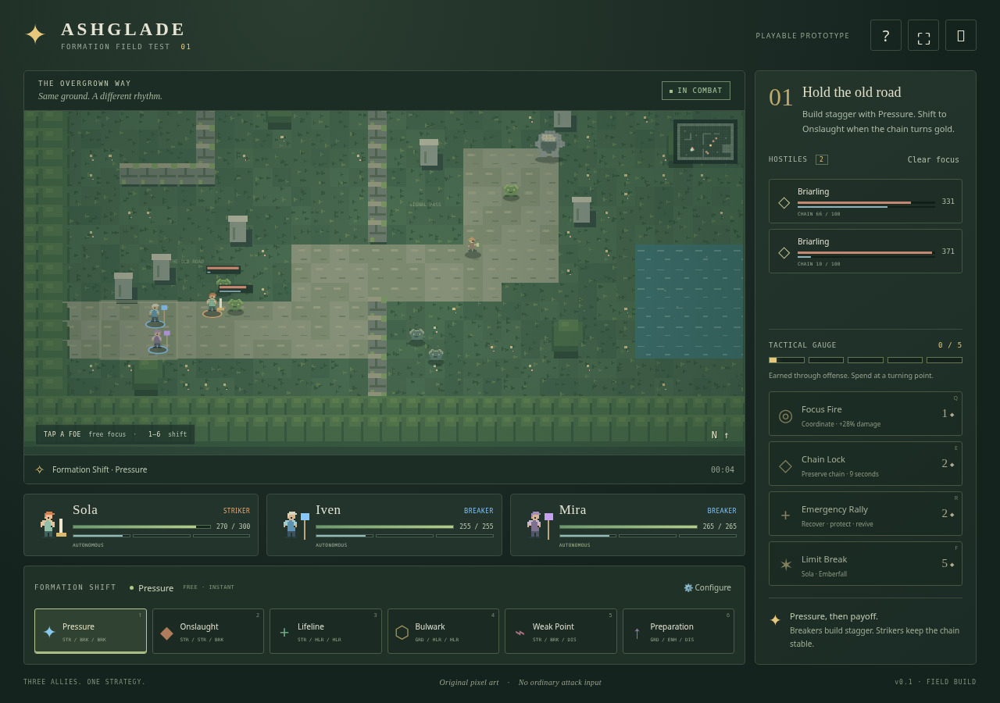

# Ashglade

An original pixel-art RPG combat playground: three autonomous companions, six Formations, one continuous map. Walk into an encounter, watch the party execute your strategy, and shift Roles or spend earned Tactical energy when the situation changes.

Built with TypeScript, Vite and Canvas 2D. No runtime libraries, external assets, accounts, API keys or game servers. All art is drawn from original pixel patterns and geometry in this repository.

## Install on Android

Download **Ashglade.apk** from [Releases](https://github.com/narmanb/experimental-jrpg/releases), open the download on your phone and choose Install. Android may ask you to allow installs from your browser. Android 8.0+ with an updated System WebView/Chrome is required. The app contains the full game and works offline; no computer or server is needed.

This is a debug-signed test build. See [android/README.md](android/README.md) for build details and verification limits.

## Run

Requires **Node.js 22.12+** (24 LTS recommended).

```sh
npm install
npm run dev
```

Open the local address printed by Vite. For an Android phone on the same network, open the printed Network address; the dev server binds to `0.0.0.0`.

```sh
npm run build
npm run preview
```

`dist/` is a self-contained static build suitable for any static host. Build with `npm run build -- --base=/experimental-jrpg/` for a GitHub Pages project subdirectory. Hosting is not configured or published automatically.

## Controls

| Action | Desktop | Touch |
| --- | --- | --- |
| Explore | WASD / arrows, or click a destination | Tap a destination or drag the virtual stick |
| Formation Shift | 1–6 or formation buttons | Six formation buttons |
| Free priority target | Click enemy or hostile card; X clears | Tap enemy; tap again clears |
| Tactical skills | Q / E / R / F | Four Tactical buttons |
| Pause/menu | Escape / P or pause icon | Pause icon |
| Configure presets | Configure button (gear in short landscape) | Same |
| Fullscreen | Fullscreen icon, where supported | Same |

Every party member attacks automatically. Individual movement is AI-controlled in combat. Menus pause the simulation. The menu provides encounter retry, full demo reset, and the recent combat log. An encounter retry restores the snapshot from its beginning, including the prior state of the rest of the map.

## A first expedition

1. Walk east toward the two briarlings. Battle begins on the same ground. Watch Sola, Iven and Mira act through their own segmented ATB meters.
2. Start in **Pressure** to build stagger. When an enemy gauge turns gold, try **Onslaught** for damage. Use **Lifeline** to heal/revive; **Bulwark** to watch the Guardian interpose while two Healers work.
3. A visible two-member patrol can hear the battle and join without resetting anything. All living participants and incoming investigators must be dealt with before victory.
4. Continue east through the narrow passage to the **Reed Caller**. Its call has a four-second windup. Tap it to focus for free; **Weak Point** assigns a Disruptor that can stop the signal. Let the call succeed on another attempt to see existing hostiles investigate.
5. Face the **Cairn Warden** in the northern court. **Preparation** applies buffs, protection and armor-breaking Weakness. Build stagger, then exploit it. Its Crushing Circle is visibly telegraphed. Recover between offensive pushes.
6. Tactical energy persists between fights. Choose occasional interventions or save five charges for Sola’s **Emberfall** Limit Break. Clearing all seven enemies completes the playground; reset to replay.

## Implemented scope

- **P0 complete:** original tile map and animated sprites; exploration and regrouping; seamless encounters; exactly three autonomous ATB allies; all six functional Roles; six instant, free Formations; health, healing, cleansing, revival, defeat and victory; chain/stagger; mouse, keyboard and touch layouts.
- **P1 complete:** grid navigation and role-aware positioning; physical Guardian cover/taunt; free priority targeting; five-charge Tactical Gauge and all four skills; interruptible Caller; actual visible patrols and bounded merged encounters.
- **P2 included:** editable presets, armored elite with area-attack pattern, animated spells/projectiles/particles, minimap, recent event log, help, pause, resets and fullscreen fallback. The Warden is the elite encounter, not a separate mini-boss.
- **P2 deferred:** audio, dedicated mini-boss, in-game tuning overlay. No campaign, progression, equipment or saving is intended in this slice.

## Verification

```sh
npm run check             # strict TypeScript
npm test                  # simulation and scenario tests
npx playwright install chromium  # once, for browser tests
npm run test:browser      # real Chromium desktop/mobile acceptance tests
npm run build             # type check + production bundle
```

Browser tests cover autonomous engagement, shifts, menus, encounter reset, preset editing, stable priority taps during Caller windups, and desktop/portrait/short landscape layouts, plus an Android-sized touch context. Simulation tests include a complete seven-enemy clear with naturally earned Emberfall energy, wall-separated revival and unreachable-target fallback. They also cover economy/anti-farming, stagger/decay, AI choices, movement, Caller outcomes, natural patrol discovery, merged victory, defeat/retry, and a full elite fight using only Formation decisions. Browser emulation has been tested; physical Android hardware, Safari and Firefox have not.

See [DESIGN_NOTES.md](DESIGN_NOTES.md) for architecture, mechanics, tuning and prototype limits. The original requirements are preserved in [docs/PROJECT_BRIEF.md](docs/PROJECT_BRIEF.md).


